# Hi, I'm Sarah!

 ### $\color{#F3E3C3}{\textsf{Hello, how are you? :D}}$

I'm a Computer Science student at Ontario Tech University (and a Seneca Polytechnic CS diploma grad).
Lately I've fallen in love with the layer between software and hardware: **GPU programming, compilers, and systems**.  
I'm still learning, and that's honestly my favourite part. Every project teaches me something new about *why* code is fast or slow, not just how to make it work. <3

### $\color{#F3E3C3}{\textsf{What I'm working on right now}}$
- **ROCm GPU Kernel Suite**: my first time writing GPU kernels! Learning HIP on an AMD Radeon 8060S. So far I got vector add to ~90% of memory bandwidth and tiled matrix multiplication up to 2.8x faster than naive
- **Lyra**: a statically-typed language I'm building in C++ to learn how compilers work, with a hand-written lexer, parser, and type checker. Now learning LLVM to build the backend
- Software Engineer at **TiketFix**
- Exploring New Cafes <3

### $\color{#F3E3C3}{\textsf{What I'm interested in (and learning about)}}$
- GPU computing & high-performance code
- Compilers & LLVM
- AI infrastructure (making AI run fast on real hardware)
- Game development (still a forever favourite)

## $\color{#F3E3C3}{\textsf{Skills}}$

#### Languages

#### GPU & Systems (currently learning)

#### Frameworks

#### ML & Data

#### Tools

### $\color{#F3E3C3}{\textsf{Fun fact:}}$ 
In my free time I love to cook, compose songs, and sing!
