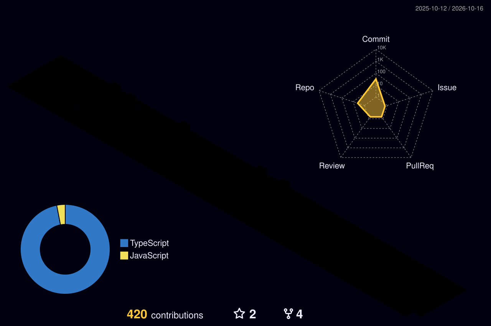

# $\color{#F06292}{\textsf{Hi, I'm Sarah!}}$ - *nightingaleX* :sparkles:

:wave: *Hello, how are you? :D*

I'm a Computer Science student at Ontario Tech University (and a Seneca Polytechnic CS diploma grad).
Lately I've fallen in love with the layer between software and hardware: **GPU programming, compilers, and systems**.  
I'm still learning, and that's honestly my favourite part. Every project teaches me something new about *why* code is fast or slow, not just how to make it work. <3

### :computer: $\color{#F06292}{\textsf{What I'm working on right now}}$
- **ROCm GPU Kernel Suite**: my first time writing GPU kernels! Learning HIP on an AMD Radeon 8060S. So far I got vector add to ~90% of memory bandwidth and tiled matrix multiplication up to 2.8x faster than naive
- **Lyra**: a statically-typed language I'm building in C++ to learn how compilers work, with a hand-written lexer, parser, and type checker. Now learning LLVM to build the backend
- Software Engineer at **TiketFix**
- Exploring New Cafes <3

### :heart: $\color{#F06292}{\textsf{What I'm interested in (and learning about)}}$
- GPU computing & high-performance code
- Compilers & LLVM
- AI infrastructure (making AI run fast on real hardware)
- Game development (still a forever favourite)

## :hammer_and_wrench: $\color{#F06292}{\textsf{Skills}}$

  

$\color{#F8C8DC}{\textsf{Currently learning:}}$ HIP, ROCm, LLVM, GPU memory hierarchy, performance benchmarking

### $\color{#F06292}{\textsf{Favourite quote}}$
> “Coding, it's an endless process of trial and error, of trying to get the right command in the right place, with sometimes just a semicolon making the difference between success and failure. Code breaks and then it falls apart, and it often takes many, many tries until that magical moment when what you're trying to build comes to life.” - Reshma Saujani

### $\color{#F06292}{\textsf{Let's connect!}}$
- [LinkedIn](https://www.linkedin.com/in/sarah-mathew-0a4a06204/)
- [Devpost](https://devpost.com/NightingaleX03)

:notes: $\color{#F8C8DC}{\textsf{Fun fact:}}$ in my free time I love to cook, compose songs, and sing!
